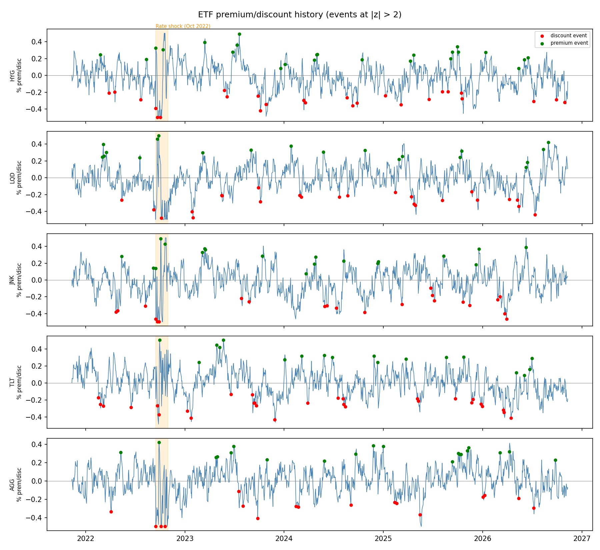
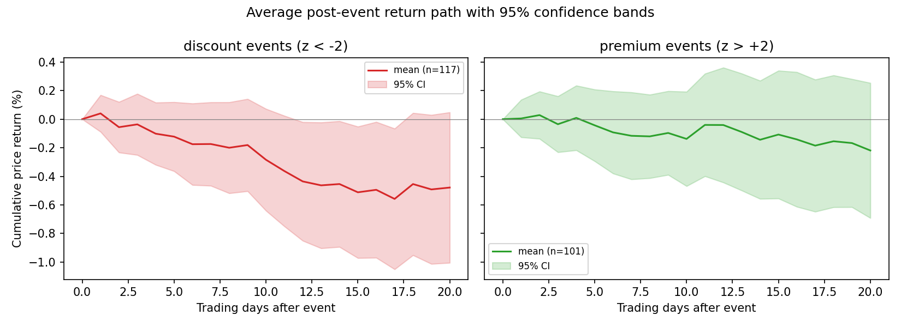
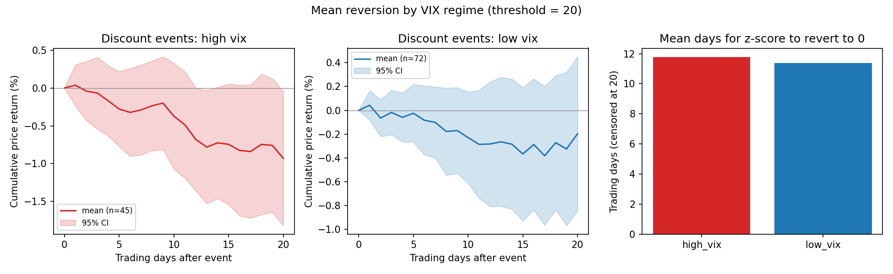
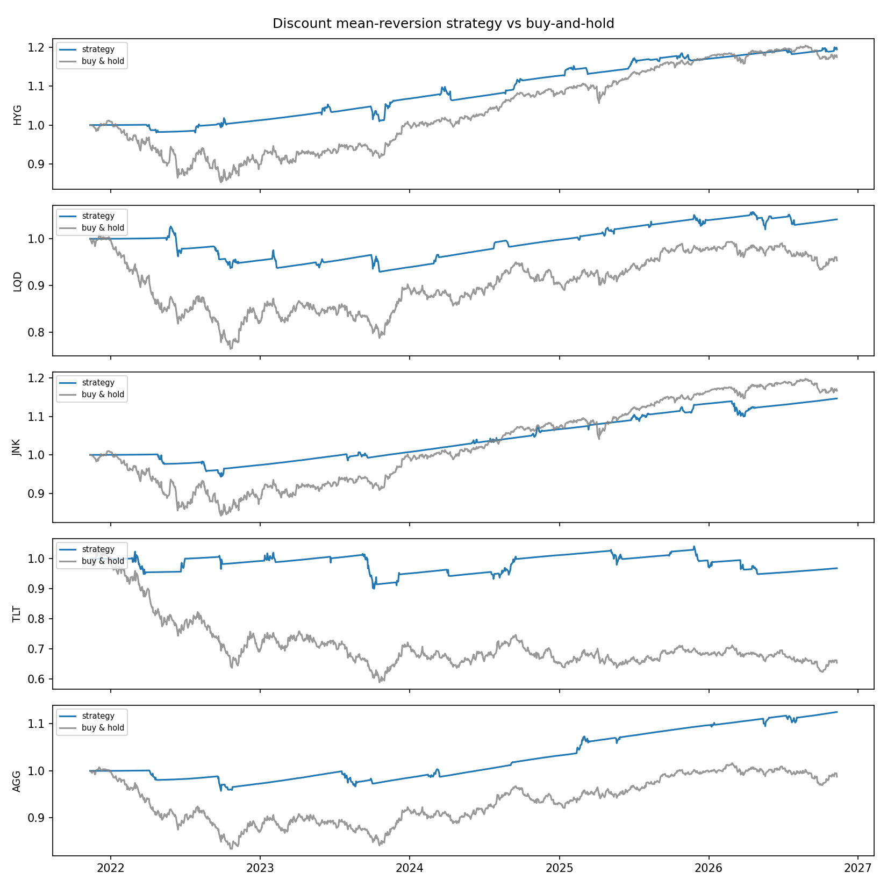

# ETF Premium/Discount Mean Reversion

[](https://github.com/rxj0102/etf-premium-discount/actions/workflows/ci.yml)


A research project analyzing **premium/discount mean reversion in fixed
income ETFs** (HYG, LQD, JNK, TLT, AGG). Fixed income ETFs trade
continuously while their underlying bonds trade over the counter and often
stale-price, so the ETF price can deviate materially from its end-of-day NAV
during stress. This project measures those dislocations as a 63-day rolling
z-score of the premium/discount, runs an event study on ±2σ episodes,
conditions the results on the VIX regime, and backtests a simple long-only
discount-reversion strategy with a Streamlit monitoring dashboard.

## Hypothesis

> When a fixed income ETF's premium/discount to NAV exceeds two standard
> deviations of its recent (63-day) history, the dislocation reflects
> temporary liquidity pressure rather than a change in fundamental value, and
> therefore mean-reverts over the following 1–20 trading days, faster and
> more profitably after deep **discounts** and during **high-VIX** regimes.

## Folder structure

```
etf-premium-discount/
├── data/
│   ├── fetch.py            # Download prices, VIX, NAV, OAS → data/raw/
│   ├── raw/                # Raw CSVs (git-ignored, reproducible)
│   └── processed/          # Derived tables (git-ignored)
├── analysis/
│   ├── spread.py           # Premium/discount, 63d z-score, ±2σ events
│   ├── reversion.py        # Event study: forward returns & reversion paths
│   └── regime.py           # High-VIX vs low-VIX regime comparison
├── backtest/
│   └── strategy.py         # Long-discount strategy backtest vs buy & hold
├── dashboard/
│   └── app.py              # Streamlit monitoring dashboard
├── notebooks/
│   └── research.ipynb      # Full narrative research notebook
├── outputs/                # Saved PNG charts
├── requirements.txt
└── README.md
```

## Setup

```bash
# 1. Install dependencies (Python 3.10+)
pip install -r requirements.txt

# 2. (Optional) set a FRED API key for credit OAS data
export FRED_API_KEY=your_key_here   # falls back to FRED's public CSV endpoint

# 3. Fetch raw data (≈5 years of daily data)
python data/fetch.py

# 4. Run the analysis pipeline (each step saves CSVs + PNG charts)
python analysis/spread.py
python analysis/reversion.py
python analysis/regime.py
python backtest/strategy.py

# 5. Launch the dashboard
streamlit run dashboard/app.py

# 6. Or explore the narrative notebook
jupyter notebook notebooks/research.ipynb
```

## Key findings

From a run on 2026-11-11 of the pipeline in Setup, steps 3 to 4 (rerun after adding T-bill interest), on yfinance prices from 2021-11-11 to 2026-11-10. **NAV is simulated** (see Corrections and caveats), so these numbers test the pipeline, not a market inefficiency. With a simulated NAV the premium/discount carries no information about future prices by construction, and the results should look like noise minus costs, which they do.

**Backtest** (long only on discounts below -2 sigma, exit at 0, two-day execution lag, 5 bps one-way cost on turnover, returns on dividend-adjusted closes, idle cash earns the 3-month T-bill rate). Sharpe ratios are in excess of the T-bill rate. Source: `data/processed/backtest_summary.csv`.

| ETF | Strategy ann. return | Sharpe | Max drawdown | Trades | Cost drag per year | Buy and hold ann. return | Buy and hold Sharpe |
|-----|------|------|------|------|------|------|------|
| HYG | 3.6% | -0.09 | -4.1% | 20 | 0.6% | 3.3% | -0.05 |
| LQD | 0.8% | -0.87 | -9.4% | 16 | 0.5% | -1.0% | -0.52 |
| JNK | 2.8% | -0.41 | -5.8% | 14 | 0.4% | 3.1% | -0.07 |
| TLT | -0.6% | -0.62 | -12.1% | 16 | 0.5% | -8.2% | -0.72 |
| AGG | 2.4% | -0.68 | -4.3% | 13 | 0.3% | -0.3% | -0.65 |

Every strategy Sharpe is negative: the strategy earns less than cash on every ETF, mostly by sitting in T-bills between trades. Buy and hold also trails cash over this window of rising rates. Trade counts of 13 to 20 over five years are too few to separate skill from chance in any case.

**Sensitivity to the entry and exit levels.** Mean excess Sharpe across the five ETFs, same rules otherwise. Source: `data/processed/sensitivity_grid.csv`. Nothing is chosen from this grid.

| Entry z | exit -0.5 | exit +0.0 | exit +0.5 |
|---|---|---|---|
| -3.0 | -0.30 | -0.35 | -0.45 |
| -2.5 | -0.39 | -0.50 | -0.51 |
| -2.0 | -0.40 | -0.54 | -0.45 |
| -1.5 | -0.50 | -0.55 | -0.52 |

No setting is positive on average, so the default (-2, 0) is not an unlucky choice; with a simulated NAV there is no edge to find.

**Event study** (118 discount and 101 premium crossings of +/-2 sigma). Mean forward return after the event (dividend-adjusted), percent. Source: `data/processed/reversion_summary.csv`.

| Event | 1 day | 5 days | 10 days | 20 days |
|-------|-------|--------|---------|---------|
| discount | 0.03% | -0.12% | -0.28% | -0.48% |
| premium | 0.01% | -0.04% | -0.14% | -0.22% |

There is no reversion pattern: discount events are not followed by gains. Charts below are from the same run.

- Spread history with stress episodes:

  

- Average post-event reversion paths (95% CI):

  

- High-VIX vs low-VIX regime comparison:

  

- Strategy vs buy-and-hold cumulative returns:

  

To test the actual hypothesis, drop real issuer NAV files into `data/raw/<TICKER>_nav_external.csv` (iShares and SPDR publish daily NAV history as free downloads) and rerun.

## Data sources

| Dataset | Source | Notes |
|---|---|---|
| ETF OHLCV prices (HYG, LQD, JNK, TLT, AGG) | Yahoo Finance via `yfinance` | 5 years daily |
| VIX (^VIX) | Yahoo Finance via `yfinance` | Daily close |
| ETF NAV | Simulated (or user-supplied) | FRED publishes no ETF NAV series; NAV is modelled as price adjusted by a mean-reverting noise term bounded at ±0.5% (amplified in Mar 2020 / Oct 2022 stress windows). Drop a real NAV export at `data/raw/<TICKER>_nav_external.csv` to override. |
| Credit OAS (BAMLH0A0HYM2, BAMLC0A0CM) | FRED via `fredapi` | Key-less fallback to FRED's public `fredgraph.csv` endpoint |

If the network is unavailable, `data/fetch.py` falls back to clearly logged,
reproducible simulations so the full pipeline still runs end to end.

## License

MIT, see [LICENSE](LICENSE).

## Corrections and caveats

- **Backtest timing.** Despite the documented next-day close execution, positions were shifted by one day, so a signal formed from day-t price and NAV earned the day-t+1 return (a fill at the very close that produced the signal). Execution is now lagged by two days (`EXEC_LAG`); pass `exec_lag=1` to reproduce the old convention.
- **Position sizing look-ahead.** Inverse-volatility weights were rescaled by the full-sample mean of inverse volatility; they now use the expanding mean.
- **The NAV series is simulated** unless you supply `data/raw/<TICKER>_nav_external.csv`. With simulated NAV the premium/discount is noise independent of subsequent price moves, so the backtest and event study demonstrate the pipeline, not a tradable edge. Add real issuer NAV data before drawing any conclusion from `backtest_summary.csv` or `event_study.csv`; regenerate them after the timing fix.
- Event-study confidence bands treat events as independent although 20-day windows overlap, so they are too narrow.
- **Transaction costs.** The backtest was frictionless. It now charges 5 bps one way on every unit of turnover, including the daily inverse-volatility resizing.
- **Interest on cash.** Idle cash earned nothing. It now earns the 3-month T-bill rate (FRED DGS3MO, saved by `data/fetch.py` to `data/raw/tbill.csv`), and Sharpe ratios are measured in excess of it. If FRED is unreachable, cash earns zero and the log says so.
- **Total returns.** P&L, buy and hold and event paths used unadjusted closes, leaving out bond ETF distributions. They now use dividend-adjusted closes; the premium/discount stays on the unadjusted close to match NAV.
- `pytest` and CI added.
